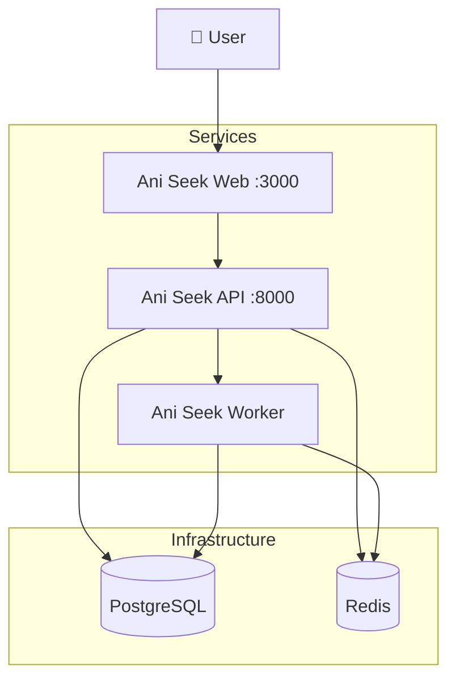
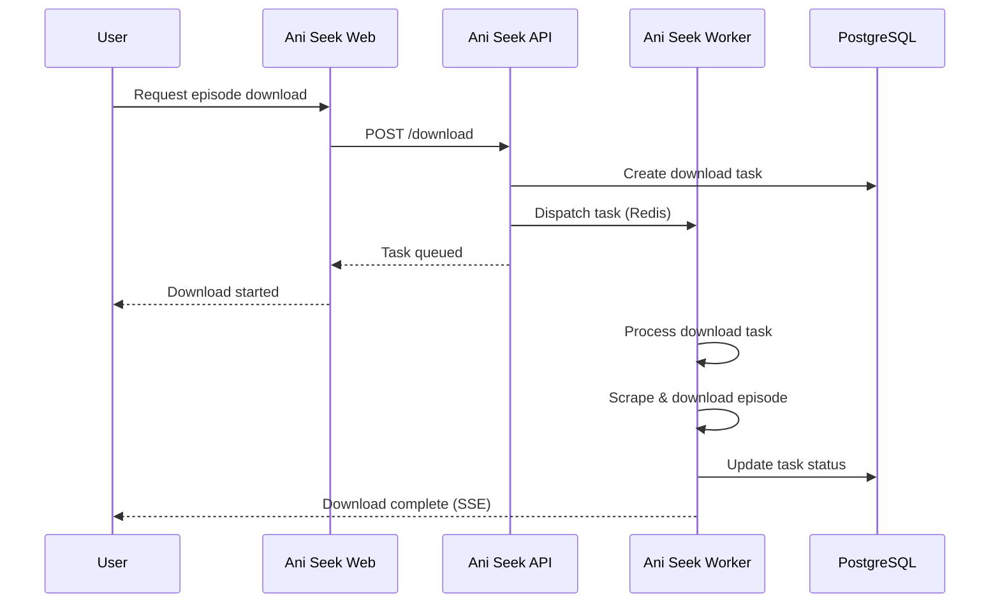

# Architecture

Ani Seek is a monorepo with three services plus PostgreSQL and Redis.

- **Ani Seek Web** (`frontend/`): React + Vite app served on port `3000`. Browsing, searching and managing anime.
- **Ani Seek API** (`backend/`): FastAPI REST API on port `8000`. Authentication, data management, SSE progress stream, and dispatch of scraping/download tasks to the worker.
- **Ani Seek Worker** (`worker/`): Dramatiq background service. Heavy operations: web scraping and episode downloads.
- **PostgreSQL**: application data and download task status.
- **Redis**: message broker for Dramatiq.

## Download flow

## Storage

The API and the worker share the `anime-data` volume, mounted at `ANIMES_FOLDER`. The worker writes downloaded episodes there; the API reads it to report disk usage and delete files. PostgreSQL and Redis use their own volumes (`postgres-data`, `redis-data`). PostgreSQL and Redis are only exposed inside the Compose network.

## Startup order

Defined by `depends_on` in `compose.yaml`:

1. `aniseek-db` and `aniseek-redis` start and become healthy.
2. `aniseek-migrate` (one-shot, [dbmate](https://github.com/amacneil/dbmate)) applies the migrations and exits successfully.
3. `aniseek-api` and `aniseek-worker` start.
4. `aniseek-web` starts once the API is healthy.

The migrations ship inside the `ghcr.io/elpitagoras14/aniseek-migrate` image, so a deployment only needs `compose.yaml` and `.env`.
